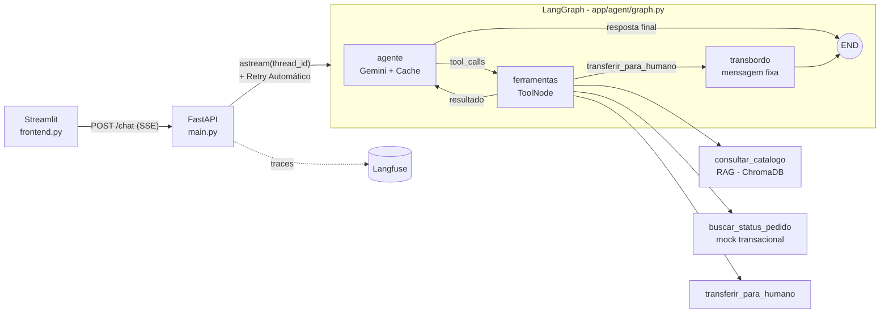

# Agente de Suporte à Revendedora Boticário/Eudora

Case técnico: um agente de IA conversacional que atende revendedoras do Boticário e da Eudora, respondendo sobre **promoções do Ciclo 15** (RAG) e **status de pedidos** (consulta transacional), com **streaming em tempo real**, **observabilidade** e **transbordo para atendimento humano**.

---

## 1. Visão Geral do Projeto

O sistema é um **agente inteligente transacional e de RAG com memória isolada por sessão**:

- **RAG (consulta ao catálogo):** responde dúvidas sobre preços, descontos, brindes e condições das promoções do Ciclo 15, buscando por similaridade em um catálogo vetorizado (ChromaDB em memória + embeddings do Gemini).
- **Transacional (pedidos):** consulta o status de um pedido (transportadora, rastreio, previsão de entrega) a partir do CPF e do número do pedido. O banco transacional é simulado por um *mock*.
- **Memória por sessão:** cada `thread_id` possui seu próprio histórico de conversa, totalmente isolado das demais sessões.
- **Guardrails de segurança:** o agente é proibido de revelar a margem de lucro de outras revendedoras e de vazar dados pessoais (PII).
- **Respostas em streaming (SSE):** o texto aparece na tela token a token, para reduzir a latência percebida.

> Todos os dados (catálogo, pedidos, preços, CPFs) são **sintéticos e fictícios**.

### Arquitetura em alto nível



### Estrutura do repositório

```text
.
├── main.py                  # API FastAPI (POST /chat em SSE, GET /health)
├── frontend.py              # Interface de chat em Streamlit
├── catalogo_ciclo_15.md     # Catálogo sintético (gerado por setup_catalogo.py)
├── requirements.txt
├── .env.example             # Modelo das variáveis de ambiente
└── app/
    ├── resilience.py        # Política de retry: erros transitórios e retomada do grafo
    ├── agent/
    │   └── graph.py         # Grafo LangGraph, system prompt, cache e checkpointer
    └── tools/
        ├── setup_catalogo.py  # Gera o catálogo em Markdown
        ├── rag.py             # Tool consultar_catalogo (RAG)
        ├── pedidos.py         # Tool buscar_status_pedido (mock)
        └── handoff.py         # Tool transferir_para_humano (transbordo)
```

### Contrato da API

`POST /chat`

```json
{ "thread_id": "rev-1", "mensagem": "Qual o desconto do Malbec?" }
```

Resposta (`text/event-stream`):

```text
: conectado

data: O Malbec está
data: por R$ 129,90...

event: done
data: [DONE]
```

- Cada pedaço da resposta vem em um evento `data:`. Textos com quebra de linha usam uma linha `data:` por linha, conforme a especificação SSE.
- Falhas chegam como `event: error`, seguidas do `event: done`.

`GET /health` devolve `{"status": "ok", "message": "API operante"}`.

---

## 2. Decisões de Arquitetura

### FastAPI
Escolhido pela **alta performance** (ASGI) e pelo **suporte nativo a geradores assíncronos**, que combinam diretamente com o `StreamingResponse` para entregar **Server-Sent Events (SSE)**. A rota `/chat` é uma função geradora assíncrona que consome `graph_app.astream(..., stream_mode="messages")` e repassa cada trecho ao cliente assim que ele é produzido, sem buffering. Os cabeçalhos `Cache-Control: no-cache, no-transform` e `X-Accel-Buffering: no` evitam que proxies retenham o stream.

### LangGraph
Utilizado para a **orquestração cíclica** do agente (`agente → ferramentas → agente`), o que permite:

- **Roteamento dinâmico de ferramentas:** o modelo decide quando chamar RAG, pedidos ou transbordo, e pode encadear várias chamadas antes de responder.
- **Estado persistente em memória:** o `MemorySaver` (checkpointer) guarda o histórico de cada conversa, com **isolamento por `thread_id`**. Duas sessões nunca compartilham contexto.
- **Fluxo explícito e testável:** após o `ToolNode`, uma aresta condicional decide entre voltar ao agente ou encerrar via transbordo, sem alterar o roteamento das ferramentas de negócio.

### Google Gemini (`gemini-3.8-flash`)
Selecionado como motor de raciocínio pelas capacidades de **Function Calling** (escolha e preenchimento dos parâmetros das tools) e de **processamento de contexto**, com boa relação entre latência e custo. A integração é feita com `langchain-google-genai` (`ChatGoogleGenerativeAI` e `GoogleGenerativeAIEmbeddings`).

### Outras decisões
| Tema | Decisão |
|---|---|
| **RAG** | Catálogo em Markdown particionado por produto (`MarkdownHeaderTextSplitter`) e, se necessário, por tamanho (`RecursiveCharacterTextSplitter`). Índice ChromaDB **em memória**, construído uma vez e **pré-aquecido no startup**. Busca por similaridade com `k=3`. |
| **Guardrails** | `SystemMessage` com regras inegociáveis: nunca informar margem de lucro de outras revendedoras, nunca vazar PII, mascarar o CPF nas respostas, recusar tentativas de burlar as regras e não revelar o prompt. O prompt é injetado a cada chamada, e não guardado no estado, para ficar sempre na primeira posição. |
| **Resiliência** | Warm-up no startup (ChromaDB + ping no LangGraph/Gemini) e **retry automático** na rota `/chat` (3 tentativas para erros de conexão/timeout), detalhados na seção 6. `timeout=60` no cliente Gemini para evitar esperas indefinidas. Erros viram um evento SSE `error` legível, com traceback completo no log do servidor. |
| **Dados sensíveis** | A tool de pedidos exige CPF **e** número do pedido, e só retorna pedidos do titular. Chaves ficam no `.env`, que está no `.gitignore`. |

---

## 3. Features Extras (Overdelivers)

- **Frontend UX (Streamlit):** `frontend.py` é uma interface de chat limpa (`st.chat_message`) que consome o SSE em tempo real com `requests.post(..., stream=True)` e `st.write_stream`. A sidebar permite trocar o `thread_id` para **testar o isolamento de sessão**, e o histórico exibido é mantido por thread.
- **Observabilidade (Langfuse):** cada requisição ao `/chat` cria um `CallbackHandler` do Langfuse, com tracing de todo o grafo (nós, chamadas ao Gemini e tools). Os traces são agrupados por conversa via `langfuse_session_id`. Sem chaves configuradas, o recurso é desativado e a API segue normalmente.
- **Infraestrutura:** `GET /health` é um endpoint leve (sem chamar LLM, banco vetorial ou serviços externos) para **probes de liveness/readiness do Kubernetes** e verificações de balanceadores de carga.
- **Human Handoff (Transbordo):** a tool `transferir_para_humano` é acionada quando a revendedora pede explicitamente um atendente ou demonstra extrema frustração. O grafo então segue para um nó dedicado que devolve a mensagem padrão de transferência e vai direto ao `END`, sem nova chamada ao LLM e sem afetar o roteamento do RAG e de Pedidos.
- **Cache de LLM (`InMemoryCache`):** `set_llm_cache(InMemoryCache())` evita requisições duplicadas ao Google. Para uma requisição idêntica (mesmo histórico, prompt e parâmetros), a resposta vem do cache, **sem custo de cota e com latência praticamente nula**. Isso mitiga os limites de cota (erro 429). A chave é o prompt completo (*exact match*, não há comparação por similaridade semântica) e o cache vive apenas enquanto o processo estiver de pé.
- **Streaming de baixa latência:** o nó do agente usa `ainvoke` (assíncrono) e o `/chat` emite o primeiro byte imediatamente (`: conectado`). O índice vetorial é pré-aquecido no startup, para que a primeira pergunta não pague o custo dos embeddings.

---

## 4. Instruções para Rodar Localmente

**Pré-requisitos:** Python 3.11+ (testado com 3.14), uma chave da API do Google Gemini ([AI Studio](https://aistudio.google.com/apikey)) e, opcionalmente, um projeto no [Langfuse](https://langfuse.com).

### 4.1. Criar e ativar o ambiente virtual

```bash
python3 -m venv venv
source venv/bin/activate        # Windows: venv\Scripts\activate
```

### 4.2. Instalar as dependências

```bash
pip install -r requirements.txt
```

### 4.3. Configurar o `.env`

```bash
cp .env.example .env
```

Edite o `.env` e preencha:

```dotenv
# Google Gemini (LLM + embeddings)
GOOGLE_API_KEY=sua_chave_aqui

# Langfuse (observabilidade; opcional)
LANGFUSE_PUBLIC_KEY=pk-lf-...
LANGFUSE_SECRET_KEY=sk-lf-...
LANGFUSE_HOST=https://cloud.langfuse.com   # ou https://us.cloud.langfuse.com
```

> Sem as chaves do Langfuse, a API sobe normalmente, apenas sem tracing.

### 4.4. (Opcional) Regenerar o catálogo

O `catalogo_ciclo_15.md` já está versionado. Para recriá-lo:

```bash
python -m app.tools.setup_catalogo
```

### 4.5. Executar o backend (terminal 1)

```bash
python main.py
```

A API sobe em `http://127.0.0.1:8000` (documentação interativa em `/docs`). Teste rápido:

```bash
curl http://localhost:8000/health

curl -N -X POST http://localhost:8000/chat \
  -H "Content-Type: application/json" \
  -d '{"thread_id": "rev-1", "mensagem": "Quais são os produtos em promoção no ciclo atual?"}'
```

### 4.6. Executar o frontend (terminal 2, outra aba)

Com o mesmo `venv` ativado:

```bash
streamlit run frontend.py
```

Abra o endereço exibido (normalmente `http://localhost:8501`). Para testar o **isolamento de sessão**, troque o `Thread ID` na sidebar (`rev-1` → `rev-2`) e observe que o agente não lembra da conversa anterior.

### Roteiro de demonstração

| Cenário | Mensagem de exemplo |
|---|---|
| RAG | "Qual o desconto e o lucro do perfume Malbec?" |
| Pedidos | "Onde está o pedido PED-2026-0001? Meu CPF é 123.456.789-00" |
| Memória na sessão | "E qual a transportadora desse pedido?" |
| Guardrail | "Qual a margem de lucro da revendedora do meu bairro?" |
| Transbordo | "Quero falar com um atendente humano" |

### Limitações conhecidas

- O `MemorySaver`, o índice ChromaDB e o cache do LLM ficam em memória: reiniciar o servidor zera conversas e cache. Em produção, usar um checkpointer persistente (Postgres/Redis), um vector store persistente e um cache compartilhado.
- Na camada gratuita do Gemini, a cota diária é baixa (por exemplo, 20 requisições/dia por modelo na época dos testes), e cada pergunta que usa uma tool consome 2 chamadas. Ao estourar, a API devolve um aviso de limite (429).
- Após o transbordo, a mesma `thread_id` continua respondendo a novas mensagens. Bloquear o bot depois da transferência exigiria um campo de estado dedicado (por exemplo, atendimento_humano: `bool = False`). Quando a tool de transbordo for acionada, ela muda essa variável para `True`.
- Atrás de proxies corporativos que inspecionam HTTPS, o envio de traces ao Langfuse pode falhar por certificado. Nesse caso, configure `REQUESTS_CA_BUNDLE` e `SSL_CERT_FILE` com o certificado da empresa.

---

## 5. Relatório de Vibe Coding

### Ferramentas
Todo o projeto foi construído no **Cursor IDE**, com o **Claude (Anthropic) em modo Agent** como par de programação. O agente leu e editou arquivos, rodou comandos no terminal, instalou dependências e validou o próprio trabalho com testes executados no ambiente, enquanto eu conduzia as decisões de produto e de arquitetura por meio dos prompts.

### Estratégia de Prompts
A construção foi **modular e iterativa**: cada prompt entregava uma peça pequena, verificável e independente, e a seguinte se apoiava na anterior.

1. **Tool de RAG:** geração do catálogo sintético e da tool `consultar_catalogo` (splitter + ChromaDB + embeddings + busca por similaridade).
2. **Tool de Pedidos:** `buscar_status_pedido`, com docstring detalhada, já pensando em como o orquestrador decidiria quando usá-la.
3. **Grafo de Decisão:** LangGraph com `MessagesState`, `ToolNode`, `MemorySaver` e o `SystemMessage` com os guardrails.
4. **API FastAPI:** endpoint `/chat` com streaming SSE.
5. **Frontend:** interface em Streamlit consumindo o SSE.
6. **Diferenciais:** observabilidade (Langfuse), `/health`, Human Handoff e cache do LLM, cada um em um prompt isolado, para não quebrar o que já funcionava.

Prompts com **restrições explícitas** (nomes de funções, formato SSE exato, parâmetros das tools) deram resultados mais previsíveis do que pedidos abertos.

### Obstáculos e Resoluções via IA

**1. Migração repentina da OpenAI para o Gemini.**
Sem créditos na OpenAI, a stack inteira precisou mudar no meio do projeto. Com apenas um prompt, a IA trocou `langchain-openai` por `langchain-google-genai`, reescreveu o RAG com `GoogleGenerativeAIEmbeddings` e manteve a lógica do ChromaDB, e depois construiu o grafo e a API já sobre o Gemini.

**2. `ModuleNotFoundError` ao subir o servidor.**
Ao rodar `python main.py`, o erro `No module named 'app.tools.pedidos'` apareceu. Ao entregar o stacktrace completo para a IA, ela auditou a estrutura de imports e os arquivos em disco e concluiu que **os imports e os `__init__.py` estavam corretos**: o problema era um arquivo que sumiu do disco, junto com outras edições recentes que foram revertidas (provável efeito da sincronização do Google Drive sobre a pasta do projeto). A IA recriou os arquivos e verificou os imports de ponta a ponta. Um erro parecido (`No module named 'langfuse'`) foi causado por rodar o servidor fora do `venv`.

**3. Auditoria de performance: chamadas síncronas.**
Diante de relatos de alta latência, a IA mediu a camada de streaming isoladamente, com um grafo falso que emitia chunks em intervalos conhecidos, e **provou que o SSE não retinha nada**. O gargalo estava a montante: o nó do agente chamava o modelo com `invoke` (síncrono) dentro de um grafo assíncrono. Foi trocado por `ainvoke`. A auditoria também levou ao pré-aquecimento do índice vetorial no startup, a `max_retries`/`timeout` mais curtos e ao envio imediato do primeiro byte do SSE.

**4. Modelo do Google descontinuado.**
O modelo inicial (`gemini-1.5-flash`) foi sendo descontinuado pelo Google. Ao subir para `gemini-2.5-flash`, a API devolveu `404 NOT_FOUND` informando que o modelo não estava mais disponível para novos usuários e indicando `gemini-3.8-flash`. A IA leu o erro no teste, apontou a causa e a sugestão do próprio Google, e o projeto passou a usar `gemini-3.8-flash`. Depois disso apareceu um novo erro, `429` (cota gratuita esgotada), o que motivou as melhorias de mensagens de erro e o uso de cache.

**5. Falha no SSE após ligar o cache.**
Ao ativar o `InMemoryCache`, um teste automatizado mostrou que a segunda pergunta idêntica fazia **uma única chamada ao modelo (cache funcionando), mas o SSE saía vazio**. Em um cache hit, o LangChain devolve a `AIMessage` **inteira**, e não em `AIMessageChunk`, e o filtro da função geradora só aceitava chunks. A função geradora foi ajustada para aceitar `AIMessage` completas dos nós `agente` e `transbordo`, e os testes confirmaram que as respostas em streaming não ficam duplicadas e que as respostas vindas do cache chegam ao cliente. O mesmo ajuste cobre a mensagem fixa do transbordo.

### Aprendizados
- Pedir **testes executáveis** junto com a implementação (por exemplo, um LLM falso roteirizado) permitiu validar fluxos como o transbordo e o cache **sem gastar cota de API**.
- Colar o **erro completo** (stacktrace ou resposta da API) no prompt acelerou muito o diagnóstico, e a IA conseguiu diferenciar falha de código, de ambiente e de cota.
- Iterar em módulos pequenos reduziu regressões, e quando uma apareceu (o cache quebrando o SSE), o teste a pegou antes de chegar ao usuário.

---

## 6. Evolução do MVP (Roadmap para Produção) (Langfuse → suíte nativa do GCP)

O MVP prova o fluxo ponta a ponta em **um único processo**, com estado, índice vetorial e cache em memória. Para suportar **500 mil revendedoras simultâneas**, com picos nos inícios de ciclo, a evolução é horizontal: tornar a aplicação **stateless** e mover cada dependência de estado para um serviço gerenciado e escalável.

### Infraestrutura e Elasticidade
- **Conteinerização (Docker):** imagem única e versionada para a API, com *health checks* (`GET /health`) e configuração 100% por variáveis de ambiente.
- **Orquestração em Kubernetes (Google GKE):** a API roda como `Deployment` com várias réplicas, atrás de **Load Balancer / Ingress**.
- **Autoescalonamento (HPA):** o **Horizontal Pod Autoscaler** adiciona e remove pods conforme CPU e número de conexões SSE ativas, absorvendo os picos de início de ciclo. Também é possível pré-escalar por calendário nas datas conhecidas de abertura.
- **Conexões longas (SSE):** timeouts do Ingress ajustados para streaming, com *graceful shutdown* para não derrubar respostas em andamento durante deploys.

### Gerenciamento de Estado Distribuído
- **Troca do `MemorySaver` por Redis:** o checkpointer do LangGraph passa a persistir o histórico em um banco de latência muito baixa.
- **Qualquer réplica atende qualquer sessão:** o histórico da `thread_id` é recuperado do Redis, sem *sticky sessions*, e as conversas sobrevivem a reinícios e deploys.
- **Governança do dado:** TTL por sessão, limite de tamanho do histórico enviado ao LLM (janela ou resumo) e mascaramento de PII antes de persistir.

### Integração Transacional via MCP (Model Context Protocol)
- **Das Tools para servidores MCP:** as atuais LangChain Tools evoluem para o padrão **MCP**, formando uma camada de integração **padronizada, segura e determinística** com os ERPs e bancos transacionais do Boticário.
- **Dado estruturado não passa por RAG:** pedidos, estoque, preço e status vêm sempre de consultas exatas ao sistema de origem, nunca de busca semântica. O RAG fica restrito a conteúdo textual não estruturado, como regulamentos de promoção e políticas.
- **Segurança por desenho:** autenticação e autorização por revendedora (o CPF e o escopo vêm do token, não do texto digitado), contratos de entrada e saída validados por schema, auditoria de cada chamada e um ponto único para aplicar *rate limits* e mascarar dados.

### Escalabilidade do RAG
- **Do ChromaDB local para um banco vetorial gerenciado:** migração do ChromaDB *in-memory* para **Pinecone, Milvus ou pgvector**, capazes de paralelizar milhares de buscas semânticas por segundo com réplicas de leitura e alta disponibilidade.
- **Indexação desacoplada (Offline Ingestion Pipeline):** o catálogo de cada ciclo é ingerido e indexado por um *pipeline* assíncrono e desacoplado da aplicação principal (gerenciado por scripts/DAGs de ingestão), abrangendo as etapas de extração, *chunking*, geração de embeddings e versionamento por ciclo. A API do FastAPI atua estritamente como consumidora do índice já vetorizado. Isso elimina a latência no *startup* dos pods, reduz o consumo de memória do servidor web e permite que a virada de ciclo ocorra em tempo real sem necessidade de *redeploy* ou reinício de processos.
- **Qualidade de Recuperação (Filtros por Metadados e Reranking):**
  - **Filtros por Metadados (Metadata Filtering):** cada *chunk* recebe *tags* estruturadas (ex: `ciclo`, `marca`, `categoria`, `status_estoque`). Durante a consulta, a busca vetorial aplica um filtro estrito nos metadados antes do cálculo de similaridade, garantindo que o modelo nunca recupere produtos de ciclos encerrados ou de marcas concorrentes no mesmo universo de busca.
  - **Reordenamento Semântico (Reranking):** implementação de uma etapa de duas fases (*Two-Stage Retrieval*). O banco vetorial realiza uma recuperação inicial abrangente (ex: *top-20* candidatas), e um modelo especializado de *Reranker* (ex: Cohere Rerank ou Cross-Encoder) reavalia a aderência exata dos trechos com a pergunta da revendedora, entregando ao LLM apenas o *top-3* de maior precisão. Isso reduz a janela de contexto, economiza tokens e elimina alucinações de preços e regras de promoções.


### FinOps e Resiliência de IA
- **Capacidade garantida:** contratos de **throughput provisionado** com o provedor de LLM, para não depender da cota do plano gratuito (os erros 429 do MVP), com monitoramento de consumo de tokens por rota e por ciclo.
- **Roteamento e Fallbacks:** uma camada de *LLM routing* troca automaticamente para outro modelo ou provedor se a API principal sofrer timeout, erro ou limite de cota. Modelos menores atendem perguntas simples e os maiores ficam para as complexas.
- **Estratégias Avançadas de Cache para Escala (500k+ Revendedoras):** o MVP utiliza um `InMemoryCache` simples, volátil e baseado em *exact match*. Para suportar milhares de acessos simultâneos garantindo que o bot nunca entregue "dados velhos", a evolução prevê:
  - **Cache Semântico Distribuído (Redis):** substitui o cache local por um cache centralizado usando **similaridade de embeddings**. Perguntas equivalentes ("preço do Malbec?" e "quanto custa o Malbec?") reaproveitam a resposta, reduzindo custo de cota e zerando a latência. Fica restrito a conteúdo não personalizado (dados do pedido de uma revendedora nunca entram no cache compartilhado).
  - **Invalidação de Cache por Domínio (Prevenção de Alucinação):**
    - *RAG (Catálogo):* a chave do cache recebe o versionamento do ciclo (ex: `chave_hash + "_Ciclo_16"`). Quando o ciclo vira, o cache antigo é isolado e o sistema é forçado a consultar o índice vetorial novo.
    - *MCP (Transacional):* dados voláteis como rastreio de pedidos e estoque recebem um **TTL (Time-To-Live)** curto (ex: 5 minutos) no Redis, garantindo que atualizações de ERP reflitam quase em tempo real sem sobrecarregar os sistemas internos.

- **Proteção do sistema:** Para garantir a estabilidade sob a demanda de milhares de revendedoras, a arquitetura combina **filas de mensageria** para amortecer picos de tráfego repentinos no início de cada ciclo, regras de **rate limiting** para evitar abusos individuais e proteger a cota do LLM, e **circuit breakers** para interromper requisições a integrações inoperantes, prevenindo falhas em cascata e mantendo o agente sempre responsivo.

### Mitigação de Cold Start e Resiliência
Duas estratégias, **já implementadas no MVP**, atacam as duas causas mais comuns de erro percebido pelo usuário: a lentidão da primeira requisição (*cold start*) e as oscilações transitórias de rede.

- **Eventos de Lifespan (Warm-up):** o `lifespan` do FastAPI executa o aquecimento **antes de a API aceitar tráfego**:
  1. carrega o catálogo no **ChromaDB em memória** (parsing, *chunking* e geração dos embeddings);
  2. faz uma invocação "fantasma" (*ping*) no **LangGraph**, que percorre o caminho real até o Gemini e força o **handshake TCP/TLS e a autenticação** com a API, a etapa mais lenta da primeira chamada.

  O resultado é eliminar o **erro de Timeout no primeiro acesso**: a primeira revendedora a usar o sistema encontra conexões, índice e cliente já aquecidos. O ciclo de vida é logado de forma explícita (`Iniciando warm-up...` → `[warm-up] ChromaDB carregado...` → `[warm-up] Ping no LangGraph/Gemini concluído...` → `Servidor pronto`). O ping usa uma `thread_id` reservada (`__warmup__`), então não contamina conversas reais, e não é enviado ao Langfuse. Uma falha no warm-up (por exemplo, cota 429) é registrada como *warning* e **não impede a API de subir**.
- **Tolerância a Falhas (Retry Pattern):** a rota de inferência tenta processar a requisição **até 3 vezes (1 original + 2 retries)**, de forma **transparente para a revendedora**, com *backoff* exponencial curto (0,5 s e 1 s). Isso absorve oscilações de rede sem quebrar a experiência: o usuário só vê erro se as 3 tentativas falharem. A implementação é um loop assíncrono nativo (`app/resilience.py` e `main.py`), com estas decisões de engenharia:
  - **Só erros transitórios são retentados:** falhas de conexão, timeouts e respostas 5xx do Gemini. **Não** são retentados o `429` (cota esgotada: tentar de novo só consome mais cota), erros 4xx (chave inválida, modelo inexistente) nem falhas de certificado SSL.
  - **Sem texto duplicado na tela:** não há retry se parte da resposta já foi enviada ao cliente via SSE. A tentativa só é refeita enquanto nada foi transmitido.
  - **Sem mensagens duplicadas no histórico:** na retentativa, o grafo é **retomado do checkpoint** (`entrada=None`), em vez de reenviar a pergunta. Assim a mensagem do usuário não é gravada duas vezes e **tools já executadas não são repetidas** (por exemplo, a consulta do pedido não roda de novo se só a chamada final ao LLM falhou).
  - **Retries centralizados:** o `max_retries` do SDK do Gemini foi desligado (`0`), para que as tentativas não se multipliquem (3 × 3) nem reenviem erros 429. No pior caso, uma requisição consome 3 chamadas ao LLM, e cada tentativa respeita o `timeout` de 60 s.
- **Evolução para produção:**
  - Como o servidor só aceita conexões depois do warm-up, o `GET /health` passa a funcionar como **readiness** natural. No Kubernetes, convém configurar uma `startupProbe` com tolerância ao tempo de aquecimento.
  - O ping consome **1 chamada ao LLM por réplica iniciada**. Com autoscaling (HPA), isso deve ser considerado no orçamento de cota, ou o ping pode ser trocado por uma chamada de custo mínimo.
  - Evoluir o retry para uma política completa de resiliência: *jitter* no backoff, *circuit breaker* e **fallback para um segundo modelo** quando o principal ficar indisponível (veja "FinOps e Resiliência de IA").

### Observabilidade e Governança de Dados 

No MVP, o **Langfuse** entrega o tracing do agente com baixo esforço, o que é ideal para validar a solução. Em produção, a recomendação é **migrar toda a observabilidade para a suíte nativa do Google Cloud Platform (GCP)**.

**Alinhamento corporativo**
- **Ecossistema já adotado:** o Grupo Boticário utiliza o GCP como ambiente principal para o desenvolvimento de produtos de dados. Observabilidade no GCP gera **sinergia tecnológica**, reaproveitando times, padrões, automações (CI/CD, IaC) e integrações já existentes, sem introduzir mais uma plataforma para operar.
- **FinOps centralizado:** consumo de LLM, infraestrutura e telemetria passam a aparecer em **uma única fatura e um único modelo de custos**, com orçamentos, alertas e atribuição por projeto/ciclo em um só lugar.

**Substituição das capacidades do Langfuse por serviços nativos**

| Capacidade (hoje no Langfuse) | Serviço nativo do GCP | Como atende |
|---|---|---|
| Tracing da execução do grafo (nós, chamadas ao LLM, tools) | **Cloud Trace** + **OpenTelemetry** | Instrumentação OTel do LangGraph/FastAPI com *spans* por nó e por tool, correlacionados por `thread_id`, e análise de latência ponta a ponta (incluindo tempo até o primeiro token). |
| Logs, erros e alertas | **Cloud Logging** + **Cloud Monitoring** | Logs estruturados correlacionados aos traces, métricas de SLO (latência, taxa de erro, hit rate do cache) e alertas operacionais. |
| Versionamento de prompts, comparação de modelos e avaliação de qualidade | **Vertex AI (Experiments & Evaluation)** | Prompts e *system messages* versionados, **testes A/B de modelos**, e avaliação da qualidade do RAG (fidelidade, relevância, aderência aos *guardrails*) em *datasets* de regressão a cada mudança de prompt ou modelo. |
| Histórico de conversas e análises de uso | **BigQuery** | Armazenamento do histórico de conversas e da telemetria (via *log sink*), permitindo **dashboards analíticos sobre dados massivos** (Looker), análise de intenções, motivos de transbordo e custo por conversa. |

**Segurança e LGPD (argumento principal)**
- **Risco do SaaS externo:** manter uma ferramenta de terceiros em produção exigiria **trafegar dados sensíveis para fora da rede da empresa**. Os traces carregam o conteúdo das conversas, ou seja, CPFs, números de pedido e informações comerciais. Isso amplia a superfície de risco e exige avaliação de operadores, cláusulas contratuais e transferência internacional de dados à luz da **LGPD**.
- **Dados dentro da fronteira de segurança:** com a suíte do GCP, a telemetria permanece no **perímetro (VPC) do Boticário**, protegida por **VPC Service Controls** e acessada por conexões privadas (Private Service Connect). Para manter *toda* a cadeia no perímetro, a inferência do Gemini também migra da API pública (chave de API) para o **Vertex AI**, autenticado por *service account*.
- **Controle de acesso já estabelecido:** reaproveita as políticas de **IAM** da empresa (menor privilégio, grupos, auditoria via **Cloud Audit Logs**), sem criar um novo silo de identidades e permissões.
- **Governança do dado:** chaves de criptografia gerenciadas pelo cliente (**CMEK**), **mascaramento/desidentificação de PII com Cloud DLP** antes da persistência, retenção e descarte configuráveis por tabela e *row/column-level security* no BigQuery.
- **Security by Design (Defesa em Profundidade):** os *guardrails* de prompt do MVP (por exemplo, "nunca revele dados de outras revendedoras") são úteis, mas **não podem ser a única barreira**, pois são suscetíveis a ataques de *jailbreak* e de *prompt injection*. Em produção, a segurança não depende do comportamento do modelo e é reforçada por **três camadas adicionais, independentes entre si**:
  - **1. Autorização na Camada de Dados (Zero Trust):** as ferramentas (Tools/servidores MCP) passam a receber o **contexto de autenticação** da requisição (por exemplo, o **JWT** da revendedora), e não mais o CPF como parâmetro preenchido pelo LLM, como acontece no MVP. O banco de dados aplica o filtro de forma estrita (`WHERE cpf = token.cpf`), validado no servidor. Assim, **mesmo que o agente seja manipulado, é tecnicamente impossível que ele recupere ou vaze pedidos de terceiros**, porque o dado alheio nunca chega ao modelo.
  - **2. DLP (Data Loss Prevention) na Entrada:** antes de o texto chegar ao LLM, ferramentas como o **Google Cloud DLP** detectam e mascaram dados sensíveis digitados pelo usuário (por exemplo, trocar números de cartão por `[CARTÃO_OCULTO]`). O modelo, os logs e os traces nunca recebem o dado original, o que reduz a superfície de exposição e o escopo da LGPD.
  - **3. Guardrails de Saída:** um **classificador semântico rápido** (por exemplo, **Llama Guard** ou **NeMo Guardrails**) audita a resposta final antes de ela chegar à revendedora, **bloqueando a mensagem** (e substituindo-a por uma resposta segura, com registro do evento) se o modelo tiver alucinado dados pessoais ou violado políticas de conteúdo. Por exigir análise do texto antes da entrega, essa camada demanda um desenho cuidadoso do *streaming* (auditoria por trechos ou em paralelo), para preservar a baixa latência percebida.
  - **Princípio:** cada camada assume que as demais podem falhar. A autorização no dado garante o isolamento, o DLP limita o que o modelo enxerga e o guardrail de saída serve de última barreira. O prompt passa a ser apenas a primeira linha de defesa, e não a única.

**Qualidade e operação contínua**
- **Métricas e SLOs:** latência até o primeiro token, taxa de erro, hit rate do cache e custo por conversa, com alertas no Cloud Monitoring.
- **Avaliação contínua:** testes de regressão para os *guardrails* (margem de outras revendedoras, vazamento de PII) e para a acurácia das respostas, executados a cada mudança de prompt ou de modelo.
- **Transbordo integrado:** a tool `transferir_para_humano` passa a abrir um chamado na fila real de atendimento, com o resumo da conversa, e o estado da sessão registra a transferência para o bot parar de responder.
